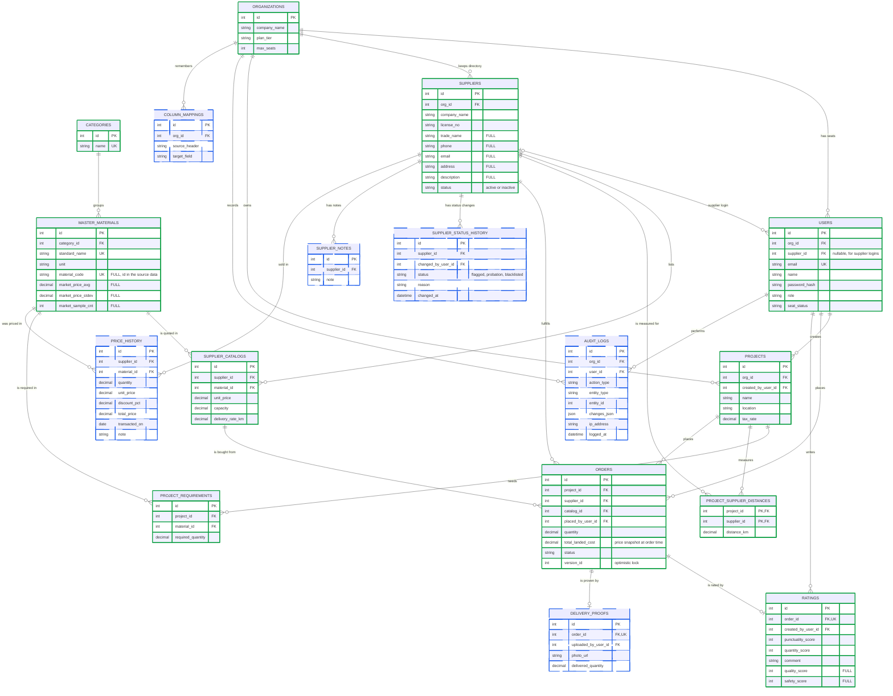

# Contract ER Model

Data model for Contract in Third Normal Form (3NF).

## How to read this model

- 🟢 **MVP** entities and attributes are built in the first release.
- 🔵 **Full Scope** entities and attributes come later. In the diagram they are tagged `FULL`, and their entity boxes are blue with a dashed border.
- Every MVP entity has a green border.

## Entities

| Entity | Scope | Purpose |
| :--- | :--- | :--- |
| `organizations` | 🟢 MVP | One row per contractor company. All data below belongs to one organization. |
| `users` | 🟢 MVP | People with a seat. Role is `admin`, `pm`, `inspector`, `executive` or `supplier`. |
| `categories` | 🟢 MVP | Groups of materials, for example Concrete, Steel, Timber. |
| `master_materials` | 🟢 MVP | The standard list of materials, so every supplier quotes the same names. |
| `suppliers` | 🟢 MVP | The supplier directory of one organization. Deactivate instead of delete. |
| `supplier_catalogs` | 🟢 MVP | One quote per supplier and material: price, capacity, delivery rate per km. |
| `projects` | 🟢 MVP | A construction job of one organization, with a tax rate. |
| `project_requirements` | 🟢 MVP | Which materials a project needs and how much. |
| `project_supplier_distances` | 🟢 MVP | Distance from a supplier to a project. Needed for the landed cost. |
| `orders` | 🟢 MVP | A purchase order. Keeps a price snapshot and a `version_id` for optimistic locking. |
| `ratings` | 🟢 MVP | One rating per order. Punctuality and quantity in the MVP. |
| `audit_logs` | 🔵 Full | Who changed what and when. |
| `delivery_proofs` | 🔵 Full | Delivery photo and the quantity that really arrived. |
| `supplier_status_history` | 🔵 Full | Flag, probation and blacklist changes with the reason. |
| `column_mappings` | 🔵 Full | Remembers how a contractor mapped spreadsheet columns last time. |
| `supplier_notes` | 🔵 Full | One short note per row about a supplier, such as "Licensed and insured". |
| `price_history` | 🔵 Full | Past purchases with quantity, price, discount and date. Used to check new quotes against real prices. |

Full Scope attributes on MVP entities:

- `ratings.quality_score` and `ratings.safety_score` (the full four part score).
- `suppliers.trade_name`, `phone`, `email`, `address` and `description` (contact details and profile text).
- `master_materials.material_code` (the id in the source data), `market_price_avg`, `market_price_stdev` and `market_sample_cnt` (market price statistics).

## Relationships and cardinality

| Relationship | Cardinality | Business rule |
| :--- | :--- | :--- |
| organization to users | 1 to many | A seat belongs to one company. The number of active users cannot pass `max_seats`. |
| organization to suppliers | 1 to many | Every company keeps its own private directory. Prices never leak across companies. |
| supplier to user | 0 or 1 to many | A supplier can have login accounts. A normal contractor user has none. |
| category to material | 1 to many | Every material sits in exactly one category. |
| supplier to catalog | 1 to many | A supplier lists many materials. |
| supplier to notes | 1 to many | A note belongs to one supplier. The same note is stored once per supplier. |
| supplier and material to price history | 1 to many each | Every past purchase belongs to one supplier and one material. |
| material to catalog | 1 to many | Many suppliers quote the same material. A supplier quotes a material only once (unique pair). |
| project to requirements | 1 to many | A material appears only once per project (unique pair). |
| project and supplier to distance | many to many | One distance for each project and supplier pair. |
| catalog to order | 1 to many | An order points to one quote. Many orders can use the same quote. |
| order to rating | 1 to 0 or 1 | An order gets at most one rating, and only after delivery. |
| order to delivery proof | 1 to 0 or 1 | One proof per order. |

## Why this is 3NF

- **1NF:** Every column holds one plain value. Lists such as "materials a supplier sells" live in `supplier_catalogs` rows, not in a column.
- **2NF:** Tables with a two part key hold only facts about the whole key. `project_supplier_distances` holds only `distance_km`. The unique pairs in `supplier_catalogs` and `project_requirements` use a single `id` key, so no part of a key leaks facts.
- **3NF:** No column depends on another non key column.
  - `suppliers.rating_score` was removed. The average rating is calculated from `ratings` by the view `v_supplier_rankings`.
  - `organizations.active_seats` was removed. It is a count of `users`.
  - `master_materials` holds the category as `category_id`, not as a name.
  - `supplier_notes` is its own table. The source data kept up to four notes in one text column separated by semicolons, which breaks first normal form.
  - `orders.total_landed_cost` is kept on purpose as a snapshot of the price at order time. It must not change when a supplier later edits a price.
