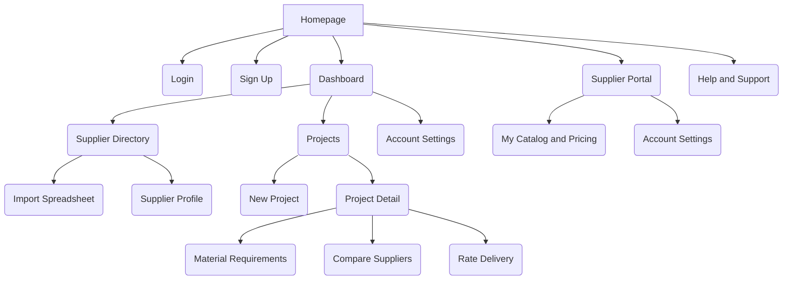
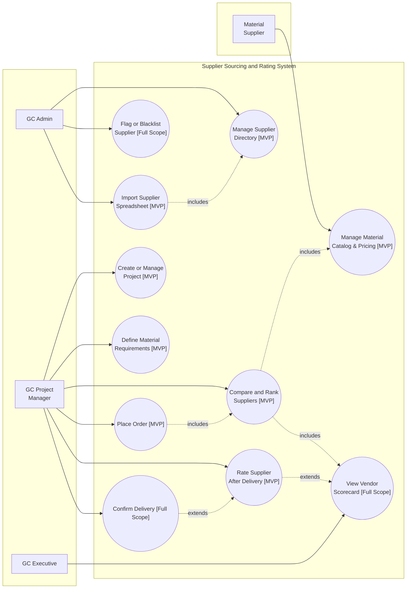

# Contract

A supplier sourcing and rating platform for general contractors.

## Overview

Contract helps general contractors manage their material suppliers in one place instead of scattered spreadsheets, phone calls, and text messages. A contractor imports the supplier list they already keep, compares real quotes side by side for any project, and sees which suppliers actually deliver on time and on budget, backed by their own team's past experience with them.

This repository holds the product requirements, business plan, and diagrams for Contract, a class project for a software engineering course.

## The Problem

Materials make up 40 to 60 percent of a construction project's cost, but general contractors only keep a 2 to 5 percent profit margin, so a single sourcing mistake can wipe out the margin. Contractors still coordinate purchasing through disconnected spreadsheets and unrecorded phone calls, and audits find 4 to 8 percent of material spend leaks out through unnoticed price inflation, freight surcharges, and uncredited returns nobody catches in time.

A few tools already exist in this space, but each one misses a piece of the problem. Kojo builds trade catalogs for mechanical, electrical, and plumbing suppliers, not raw materials like concrete or steel. Toolbx is an online storefront owned by the supplier, so a contractor working with many suppliers ends up with many separate logins. ProcurePro handles bidding and subcontract paperwork but stops once the purchase order is signed. Procore does almost everything, but it is priced by yearly construction volume and does not track materials at the line item level. None of them give a contractor one simple way to compare suppliers by price and track record together.

## Features

Contract is four parts working together.

- **Supplier Import [MVP]:** A contractor uploads the spreadsheet they already keep their suppliers in, in whatever format it is already in. Contract reads the header row and suggests which column matches which field, price, capacity, delivery rate, and so on, so the contractor confirms the mapping instead of retyping every supplier by hand.
- **Supplier Directory [MVP]:** Contractors add and manage their suppliers in one place. Suppliers list what materials they sell, their prices, how much they can produce, and their delivery rate per kilometer.
- **Project Sourcing [MVP]:** For each project, a contractor lists what materials they need. Contract shows every matching supplier with the total landed cost, price plus delivery, so contractors compare real numbers instead of just a quoted unit price.
- **Performance Rating [MVP]:** After a delivery, the project manager rates the supplier on things like on time delivery and correct quantity. Over time this builds a performance score for each supplier that gets factored into future rankings alongside price.

## Organization Chart

This is the page map for the MVP, showing which page leads to which.

**Dashboard** is what a GC Admin or GC Project Manager lands on after login. **Supplier Portal** is the separate, simpler side a Material Supplier logs into to manage their own catalog and pricing, nothing else. Everything under **Project Detail** is where the actual sourcing decision happens, from listing what a project needs down to rating the delivery afterward.

## Use Case Diagram

## MVP Scope

The MVP goal is to prove the core value proposition, pick a supplier for a material based on real landed cost and real performance, not guesswork, with the smallest set of features that make that judgment possible and trustworthy.

**What's in [MVP]**

- Supplier directory, create, update, and deactivate
- Spreadsheet import with column mapping, including a basic suggested match based on header text
- Project creation with a basic material requirement list
- Supplier entered catalog, material, price per unit, capacity, delivery rate
- Side by side sourcing comparison with computed landed cost, filterable by price, distance, or rating
- A simple post delivery rating that feeds a basic price plus rating ranking score

**What's out for now [Full Scope]**

- Full Kanban or Gantt project management, a well solved problem with tools already built for it
- Remembering a contractor's column mapping for their next upload
- A formal order and delivery confirmation workflow
- The full four part weighted score, quality, delivery, commercial, and safety
- Blacklisting and probation status
- Schedule syncing, embedded financing, and other later phase ideas from the roadmap

## Project Status

This repository currently holds the requirements analysis, business plan, and diagrams for Contract. Implementation has not started yet.

## Team

Dimas Dermawan | M11402825, 陳韋翰 | M11505112
---

##  Multi-User Access, Seat-Based Billing & Audit Logging

To support multi-person team collaboration within a single enterprise while maintaining accountability and financial sustainability, **Contract** implements a seat-based subscription model and detailed user-level audit tracking:

1. **Company-Level Organization Accounts & Multi-User Support:**
   * Companies subscribe under a single Organization Tenant.
   * Multiple personnel from the same company can access the platform under unique corporate credentials, avoiding shared password risks.
2. **Seat-Based Licensing Model (Per-Seat Billing):**
   * Standard subscription plans include a base allocation of user seats (e.g., 3 seats included in Starter Plan, 10 seats in Growth Plan).
   * **Additional User Seats:** Adding new team members beyond the plan's base quota automatically incurs an additional monthly seat fee (e.g., +$15/user/month).
   * Organization Admins can manage seats, send user invitations, and adjust license quotas directly in the Billing Dashboard.
3. **Comprehensive User Audit Logs (Activity & Modification Tracking) [Full Scope]:**
   * **Full Traceability:** Every creation, update, or deletion action across the platform—including order placements, catalog updates, price modifications, and post-delivery ratings—is permanently logged.
   * **Log Details:** Each record captures the exact **User ID, User Name, Timestamp, IP Address, Modified Module, and Action Type (Create / Update / Delete)** along with before-and-after data diffs.
   * **Audit Log Viewer:** Company Admins and Executives can query historical activity logs to investigate discrepancy issues and ensure strict operational governance.
4. **Role-Based Access Control (RBAC):**
   * **Admin:** Manage billing seats, user invitations, audit logs, and enterprise settings.
   * **Project Manager (PM):** Define project material requirements, compare landed costs, and issue purchase orders.
   * **Field Inspector:** Submit delivery receipt photos (PoD) and conduct post-delivery rating forms.
5. **Optimistic Locking for Concurrent Edits:**
   * When multiple employees view or edit the same purchase order simultaneously, records maintain a `version_id`. If user A updates a record while user B is editing it, user B is prompted to refresh before saving, preventing accidental data overwrites.

##  Detailed User Stories

- **As a GC Project Manager (PM):**
  * I want to specify required material quantities for a project so that I can automatically calculate and compare the total landed cost across all matching suppliers. `[MVP]`
  * I want to rate suppliers on delivery accuracy and punctuality after each fulfillment so that my team can maintain a reliable track record for future procurement. `[MVP]`
- **As a GC Executive / Admin:**
  * I want to add new team members to our company account with per-seat billing updates so that our expanding procurement team can collaborate securely. `[MVP]`
  * I want to review system audit logs to track who modified specific purchase orders or supplier ratings for full transparency. `[Full Scope]`
- **As a Material Supplier:**
  * I want to manage and update my product catalog, unit pricing, and freight rates online so that contractors always receive accurate real-time quotes. `[MVP]`
  * I want to view my past performance ratings and delivery feedback so that I can improve my service and secure more purchase orders. `[MVP]`
---
---

##  Technical Architecture & System Specs

### Tech Stack Selection (MVP)
- **Frontend:** Next.js (React), Tailwind CSS, Mermaid.js
- **Backend:** Node.js (Express) / Python FastAPI
- **Database:** PostgreSQL (Relational schema normalized to 3NF, with multi-tenant isolation, views, indexes, and audit tables)
- **Authentication & Billing:** NextAuth.js / Auth0 + Stripe API (Seat subscription management)
- 
### Landed Cost Calculation Logic
$$\text{Total Landed Cost} = (\text{Unit Material Price} \times \text{Quantity}) + (\text{Distance in km} \times \text{Delivery Rate per km}) + \text{Tax}$$

---

## Database Schema Design (3NF Normalized)

| Table Name | Scope | Primary Fields | Description |
| :--- | :--- | :--- | :--- |
| **`organizations`** | MVP | `id`, `company_name`, `tenant_id`, `plan_tier`, `max_seats`, `active_seats` | Enterprise tenant master data. |
| **`users`** | MVP | `id`, `org_id`, `email`, `role`, `name`, `seat_status` | User accounts mapped to corporate roles and seats. |
| **`projects`** | MVP | `id`, `org_id`, `name`, `location`, `created_by_user_id` | Project master data table. |
| **`master_materials`**| MVP | `id`, `category`, `standard_name`, `unit` | Standardized raw material catalog master. |
| **`suppliers`** | MVP | `id`, `company_name`, `license_no`, `rating_score` | Supplier directory profiles. |
| **`supplier_catalogs`**| MVP | `id`, `supplier_id`, `material_id`, `unit_price`, `capacity`, `delivery_rate_km` | 3NF normalized mapping for supplier quotes and freight rates. |
| **`project_requirements`**| MVP | `id`, `project_id`, `material_id`, `required_quantity` | Detailed material quantity requirements per project. |
| **`orders`** | MVP | `id`, `project_id`, `supplier_id`, `catalog_id`, `version_id`, `total_landed_cost`, `status` | Purchase orders with optimistic concurrency locking (`version_id`). |
| **`ratings`** | MVP | `id`, `order_id`, `created_by_user_id`, `punctuality_score`, `quantity_score` | Post-delivery performance rating tied to an order. |
| **`audit_logs`** | Full Scope | `id`, `org_id`, `user_id`, `action_type`, `entity_type`, `entity_id`, `changes_json`, `timestamp`, `ip_address` | System-wide immutable audit log. |

### Database Optimization & Integrity Strategies
- **Database Views (`v_supplier_rankings`):** A pre-defined database view encapsulating complex SQL joins across `suppliers`, `supplier_catalogs`, and `ratings` to calculate aggregated landed costs and rating scores, abstracting query logic for the frontend.
- **Transactions & ACID Compliance:** Critical operations like issuing purchase orders and deducting supplier capacity execute inside SQL transactions (`BEGIN TRANSACTION ... COMMIT / ROLLBACK`) to maintain data integrity and avoid partial updates during failures.
- **Indexing Strategy:** B-tree indexes applied on `supplier_catalogs(material_id, unit_price)` for fast side-by-side quote comparison, `orders(project_id)` for quick lookup, and `audit_logs(org_id, timestamp)` for high-performance log filtering.

---

## Core RESTful API Endpoints

- `GET /api/v1/suppliers` `[MVP]` - Fetch filtered supplier directory by location and material.
- `POST /api/v1/suppliers/import` `[MVP]` - Import supplier CSV/Excel with column header mapping.
- `POST /api/v1/sourcing/compare` `[MVP]` - Submit project requirements and calculate landed costs (Queries `v_supplier_rankings` view).
- `POST /api/v1/orders` `[MVP]` - Issue a new purchase order to a selected supplier (Executed within SQL Transaction).
- `POST /api/v1/ratings` `[MVP]` - Submit a post-delivery performance rating.
- `POST /api/v1/org/seats/invite` `[MVP]` - Invite a new user seat (triggers per-seat billing charge).
- `GET /api/v1/admin/audit-logs` `[Full Scope]` - Query historical modification logs filtered by user, timestamp, or entity.

---

## Feasibility Enhancements & Solutions

To strengthen platform adoption and data trustworthiness, we propose four feasible enhancement solutions:

1. **Single-Sided Tooling (Excel/CSV Import) [MVP]:**
   * *Problem:* Cold-start issues when suppliers have not yet registered.
   * *Solution:* Allow GCs to import their existing supplier spreadsheets so the platform functions immediately as a private vendor directory without waiting for supplier onboarding.
2. **Proof-of-Delivery (PoD) Photo Verification [Full Scope]:**
   * *Problem:* Subjective rating bias from field workers.
   * *Solution:* Enable field staff to upload delivery receipt photos, automatically validating delivered vs. ordered quantities to back ratings with verifiable proof.
3. **Interactive ROI Calculator [MVP]:**
   * *Problem:* Demonstrating value for the flat monthly fee ($199 Starter / $499 Growth).
   * *Solution:* Integrate an ROI calculator showing how preventing a 1% pricing error on a single concrete order yields $2,000+ in savings.
4. **Multi-Tenancy Data Isolation [MVP]:**
   * *Problem:* GC concerns over leaking confidential pricing to competitors.
   * *Solution:* Enforce strict tenant-level data isolation (PostgreSQL Row-Level Security), ensuring custom supplier ratings and historical quotes remain strictly private to GC executives.
